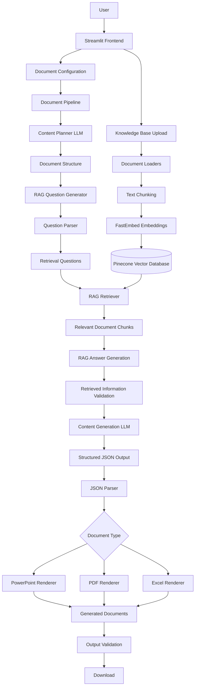
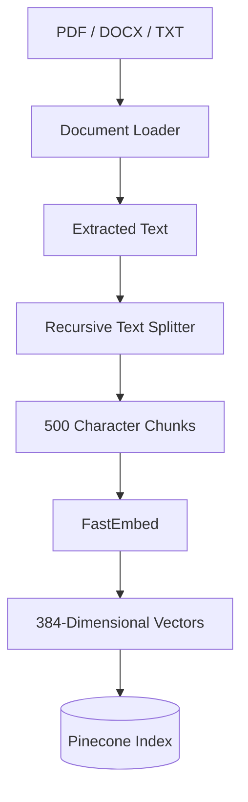
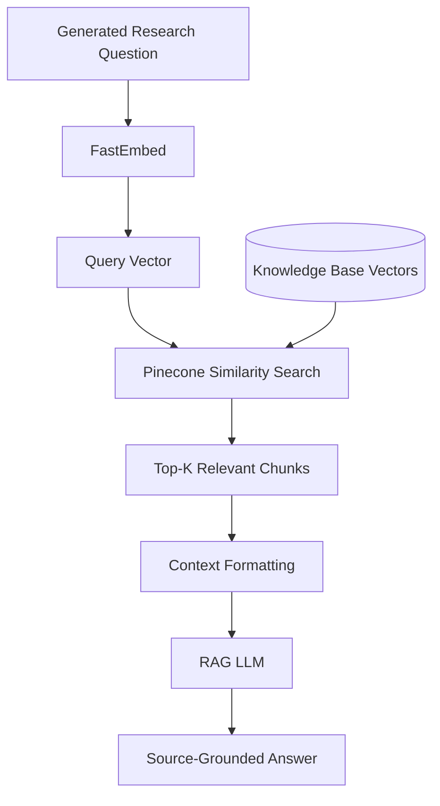

# DOCUMENT-MANAGER
### AI-Powered Document Generation Engine

An intelligent document generation system that transforms natural-language instructions into structured **PowerPoint presentations, PDF reports, and Excel workbooks** using Large Language Models (LLMs), Retrieval-Augmented Generation (RAG), and automated document rendering.

DOCUMENT-MANAGER follows a multi-stage AI pipeline that understands the user's requirements, plans the document structure, generates targeted research questions, retrieves relevant information from uploaded knowledge-base documents, generates structured content, and converts it into downloadable documents.

Rather than relying on a single LLM call to generate an entire document, the system separates planning, information retrieval, content generation, and document rendering into independent components.

---

## Table of Contents

- [Project Overview](#project-overview)
- [Key Features](#key-features)
- [System Architecture](#system-architecture)
- [Complete Pipeline Workflow](#complete-pipeline-workflow)
- [Technology Stack](#technology-stack)
- [Project Structure](#project-structure)
- [Quantitative Configuration](#quantitative-configuration)
- [Installation and Setup](#installation-and-setup)
- [Environment Variables](#environment-variables)
- [How to Use](#how-to-use)
- [Knowledge Base and RAG](#knowledge-base-and-rag)
- [Testing](#testing)
- [Output Structure](#output-structure)
- [Current Limitations](#current-limitations)
- [Deployment](#deployment)
- [Future Improvements](#future-improvements)

---

# Project Overview

Generating high-quality business documents from natural-language instructions involves more than simply asking an LLM to write content.

A reliable document-generation system must understand the user's objective, identify the information required, retrieve relevant facts, organize the content, and produce a properly structured output.

DOCUMENT-MANAGER addresses this problem through a modular, multi-stage AI architecture.

The system supports three document formats:

| Document Type | Output Format | Purpose |
|---|---|---|
| PowerPoint Presentation | `.pptx` | Presentations, business reviews, and analytical summaries |
| PDF Report | `.pdf` | Structured reports, research documents, and industry analysis |
| Excel Workbook | `.xlsx` | Structured datasets, analytical tables, and multi-sheet workbooks |

Users can upload their own documents to a knowledge base. The RAG pipeline retrieves relevant information from these documents and supplies it to the content-generation stage.

### Core Processing Philosophy

The system follows four major principles:

1. **Plan before generating:** Understand the document requirements and determine its structure before creating content.
2. **Retrieve before writing:** Identify the information needed and retrieve supporting evidence from uploaded documents.
3. **Generate structured content:** Produce format-specific content instead of unrestricted conversational responses.
4. **Render deterministically:** Use dedicated Python libraries to convert structured content into actual document files.

---

# Key Features

### 1. Multi-Format Document Generation
Generate PowerPoint presentations, PDF reports, and Excel workbooks through a unified interface.

### 2. Intelligent Content Planning
Dedicated LLM-based planners analyze the user's request and determine document structure, required information, sections, slides, and worksheets.

### 3. Automated Research Question Generation
Convert document requirements into targeted retrieval questions that help identify relevant information in the knowledge base.

### 4. Document Ingestion
Upload PDF, DOCX, and TXT files to create a searchable knowledge base.

### 5. Retrieval-Augmented Generation
Use FastEmbed to generate vector embeddings and Pinecone to retrieve relevant document chunks based on semantic similarity.

### 6. Source-Grounded Content Generation
Pass retrieved answers and source references to the Content Generation LLM to reduce unsupported information.

### 7. Structured Output Generation
Generate JSON-formatted content that can be consumed by format-specific rendering modules.

### 8. Automated Document Rendering
Create downloadable PowerPoint, PDF, and Excel files using dedicated Python libraries.

### 9. Professional Document Styling
An automatic enhancement layer applies professional styling to all generated documents — navy-themed headers, accent bars, zebra-striped tables, proper fonts, page numbers, and consistent color schemes across all three formats.

### 10. Robust Error Handling
Built-in retry logic with rate-limit awareness (3 retries, 30s delay), fallback content builder for JSON parsing failures, and UTF-8 encoding safety ensure the pipeline runs end-to-end without crashes.

### 11. Interactive Streamlit Interface
Upload source documents, configure generation requests, monitor the process, and download generated documents through a web interface.

### 12. Cloud Deployment Ready
Designed for deployment on Streamlit Community Cloud with secrets management and environment variable support.

---

# System Architecture

The application consists of five major layers:

| Layer | Responsibility |
|---|---|
| Frontend Layer | Accepts user input and manages document uploads and downloads |
| Planning Layer | Understands document requirements and creates a structured plan |
| Retrieval Layer | Generates research questions and retrieves source information |
| Content Generation Layer | Converts validated information into structured document content |
| Rendering Layer | Converts structured content into downloadable files |

## High-Level Architecture Diagram



---

# Complete Pipeline Workflow

The document-generation process is divided into the following stages.

## Stage 1: User Input and Frontend

**Implementation:** `app.py`

The application uses Streamlit to provide an interactive interface.

The user selects a document type and supplies a natural-language request along with additional context.

The frontend also provides a Knowledge Base section for uploading source documents and a Generated Documents section for accessing generated files.

The frontend passes the user's input to the backend through:

```python
run_document_chain(
    document_type=document_type,
    user_prompt=user_prompt,
    available_context=available_context
)
```

The frontend and backend are kept separate so that the generation pipeline can be tested or reused independently of the Streamlit interface.

## Stage 2: Content Planning

**Implementation:** `planners/`

The Content Planner is the first LLM stage.

Its purpose is to understand the user's objective and convert an unstructured request into a structured document plan.

The system uses three dedicated planners:

| Planner | Responsibility |
|---|---|
| `ppt_planner.py` | Defines presentation objectives, slide structure, content requirements, metrics, and visual requirements |
| `pdf_planner.py` | Defines report sections, research requirements, methodology, findings, and references |
| `excel_planner.py` | Defines worksheets, data fields, calculations, and workbook structure |

For example, if a user requests a presentation explaining quarterly business performance, the planner may identify the following requirements:

- Executive summary
- Revenue performance
- Profitability analysis
- Customer performance
- Business segment analysis
- Growth drivers
- Risks and challenges
- Strategic opportunities
- Key takeaways

The planner also identifies missing information and determines which facts or metrics must be retrieved before generating the final content.

**Why is this stage necessary?**

A broad natural-language request is not sufficiently specific for reliable information retrieval or structured document generation.

The planner converts the user's intent into a clear document specification that downstream components can process.

## Stage 3: RAG Question Generation

**Implementation:** `question_generation/`

The RAG Question Generator receives the original request, additional context, document type, and content plan.

It identifies the factual information required to complete the document and converts those requirements into targeted retrieval questions.

For example:

```json
[
  "What was the company's total revenue in FY2025?",
  "What was the reported operating profit?",
  "Which business segments contributed to revenue?",
  "What growth drivers were identified in the report?",
  "What risks and challenges were documented?"
]
```

These questions are generated dynamically by the LLM.

The `question_parser.py` module processes the generated output.

Its responsibilities include:

- Removing Markdown code fences.
- Parsing JSON-formatted responses.
- Extracting JSON arrays when additional text is present.
- Handling numbered and bulleted question lists.
- Removing invalid questions.
- Removing duplicate questions.
- Enforcing the maximum question limit.

**Why is this stage necessary?**

Searching a vector database with a broad request such as "Create a business report" is less effective than searching with specific questions about revenue, profitability, customers, and industry trends.

Question generation transforms the document plan into focused retrieval queries.

## Stage 4: Knowledge Base Ingestion

**Implementation:** `rag/ingest.py`

This stage prepares uploaded documents for semantic search.

The ingestion pipeline performs four major operations.

### 4.1 Document Loading

Supported document formats:

| Format | Loader |
|---|---|
| PDF | `PyPDFLoader` |
| DOCX | `Docx2txtLoader` |
| TXT | `TextLoader` |

The loaders extract text and create LangChain Document objects containing page content and metadata.

### 4.2 Text Chunking

Long documents are divided into smaller chunks using `RecursiveCharacterTextSplitter`.

Current configuration:

```python
RecursiveCharacterTextSplitter(
    chunk_size=500,
    chunk_overlap=50
)
```

Each chunk contains approximately 500 characters, with 50 characters of overlap between adjacent chunks.

Overlap helps preserve context when an important sentence or paragraph crosses a chunk boundary.

### 4.3 Embedding Generation

The project uses FastEmbed with:

```python
FastEmbedEmbeddings(
    model_name="sentence-transformers/all-MiniLM-L6-v2"
)
```

The embedding model converts text into a numerical vector representation.

The selected model produces 384-dimensional embeddings.

These vectors represent semantic information and allow the retrieval system to search for content based on meaning rather than relying exclusively on exact keyword matches.

### 4.4 Vector Storage

Generated embeddings and their metadata are stored in Pinecone.

Each vector contains information such as:

- Vector identifier
- Embedding values
- Original text
- Source document
- Page information, where available

Pinecone provides persistent vector storage and similarity search.

**Why is ingestion separated from generation?**

Uploaded documents are processed and indexed before they are needed for document generation.

This avoids repeatedly extracting and embedding the entire source document for every generation request.

## Stage 5: Retrieval-Augmented Generation

**Implementation:** `rag/retriever.py`, `rag/rag_chain.py`, `rag/rag_service.py`

This stage retrieves relevant information from the knowledge base and uses an LLM to formulate answers based on the retrieved context.

The process is:

1. Receive a generated research question.
2. Convert the question into an embedding using the same model used during ingestion.
3. Query Pinecone using vector similarity search.
4. Retrieve the most relevant document chunks.
5. Reconstruct the retrieved context with source metadata.
6. Pass the question and context to the RAG LLM.
7. Generate a source-grounded answer.

The default retrieval configuration is:

```env
RAG_TOP_K=5
```

This means the retriever requests up to five relevant chunks for each question.

The RAG prompt instructs the LLM to:

- Answer using the supplied context.
- Avoid inventing facts or numerical information.
- Report when the requested information is unavailable.
- Retain source references.

**Why use RAG?**

LLMs do not automatically have access to private documents, uploaded reports, or organization-specific information.

RAG provides a mechanism to retrieve relevant information from user-provided documents and supply it to the model during generation.

It improves grounding and source traceability, although it does not guarantee that every generated statement is correct.

## Stage 6: Retrieved Information Validation

**Implementation:** `pipeline/document_pipeline.py`

Retrieved answers are not passed directly to the Content Generator.

The pipeline first validates and filters the results.

It removes:

- Failed retrieval responses.
- Empty answers.
- Responses indicating that relevant information was not found.
- Answers without source references.

The pipeline also enforces context-size limits.

| Parameter | Value |
|---|---:|
| Maximum retrieval questions | 12 |
| Maximum characters per answer | 1,200 |
| Maximum combined retrieved context | 9,000 |

If no meaningful source-backed information is retrieved, the pipeline stops instead of generating a document from unsupported material.

**Why is this stage important?**

It reduces the likelihood that failed or irrelevant retrieval results will influence the final document.

## Stage 7: Content Generation

**Implementation:** `content_generation/`

After retrieval and validation, the Content Generation LLM converts the original request and retrieved information into structured document content.

Three separate prompts are used:

| Prompt | Responsibility |
|---|---|
| `ppt_prompt.py` | Generates structured presentation content |
| `pdf_prompt.py` | Generates structured report content |
| `excel_prompt.py` | Generates structured workbook content |

The content generator receives the retrieved information in a consistent serialized format.

For example:

```json
[
  {
    "question": "What was the reported revenue?",
    "answer": "Information retrieved from the uploaded report.",
    "sources": ["industry_report.pdf"]
  }
]
```

The LLM uses this information to generate the requested document content.

**Why use separate content-generation prompts?**

PowerPoint, PDF, and Excel documents have different structural requirements.

A presentation is organized into slides, a report into sections, and an Excel workbook into worksheets, headers, and rows.

Dedicated prompts allow the system to generate content suitable for each rendering format.

## Stage 8: Structured Content Parsing

**Implementation:** `pipeline/document_pipeline.py`

The Content Generation LLM returns JSON-formatted text.

The pipeline parses this response using Python's JSON parser.

The parsing process includes:

1. Removing Markdown code fences.
2. Parsing the JSON string.
3. Checking that the root structure is a dictionary.
4. Passing the parsed Python object to the rendering layer.

Structured output provides a predictable interface between probabilistic LLM generation and deterministic Python rendering.

## Stage 9: Document Rendering

**Implementation:** `renderers/`

The renderer factory selects the correct renderer based on the requested document type.

| Renderer | Library | Output |
|---|---|---|
| `pptx_renderer.py` | Python-pptx | PowerPoint presentation |
| `pdf_renderer.py` | ReportLab | PDF report |
| `excel_renderer.py` | OpenPyXL | Excel workbook |

### PowerPoint Renderer

The PowerPoint renderer:

- Creates a new presentation.
- Sets slide dimensions.
- Creates slides with titles and content.
- **Enhancement layer** applies: dark navy title slide, white content slides, Calibri fonts (38pt/26pt/15pt), blue accent bars, and slide numbers.
- Saves the `.pptx` file.

### PDF Renderer

The PDF renderer:

- Creates a PDF document with custom margins.
- **Enhancement layer** provides: centered title with accent underline, navy headings, justified body text, zebra-striped tables with navy headers, page numbers, and accent line at page top.
- Saves the `.pdf` file.

### Excel Renderer

The Excel renderer:

- Creates an Excel workbook with worksheets.
- Adds column headers and populates data rows.
- **Enhancement layer** applies: navy headers with white text, zebra-striped rows, frozen header row, auto-fit columns, colored sheet tabs, and clean borders.
- Saves the `.xlsx` file.

### Document Enhancement System

**Implementation:** `renderers/enhancer.py`

The enhancer module monkey-patches all three renderers at import time via `document_processor/__init__.py`. This applies professional styling without modifying any original renderer code. All enhancements are wrapped in try/except so failures never break the pipeline.

**Why use separate renderers?**

The content-generation layer determines what information belongs in the document.

The rendering layer determines how that information is converted into the actual file.

Keeping these responsibilities separate makes the system modular and easier to extend.

## Stage 10: Output Validation and Download

After rendering, the pipeline verifies that the output file exists and is not empty.

The generated file path and intermediate pipeline results are returned to the Streamlit frontend.

The frontend displays the generated document in the Generated Documents section and allows the user to download it.

---

# Technology Stack

| Technology | Purpose |
|---|---|
| Python | Core programming language |
| Streamlit | Interactive frontend |
| LangChain | LLM orchestration and document-processing integration |
| Groq | LLM inference |
| Pinecone | Vector database |
| FastEmbed | Text embedding generation |
| sentence-transformers/all-MiniLM-L6-v2 | Embedding model |
| Pydantic | Data modelling dependency |
| PyPDF | PDF document loading |
| Docx2txt | DOCX document loading |
| LangChain Community | Document loaders and integrations |
| LangChain Text Splitters | Document chunking |
| Python-pptx | PowerPoint rendering |
| ReportLab | PDF rendering |
| OpenPyXL | Excel rendering |
| python-dotenv | Environment-variable management |

### Technology Roles

**LangChain:** Connects prompt templates, language models, parsers, and document-processing components.

**Groq:** Provides the LLM inference service used by the planning, question-generation, RAG, and content-generation stages.

**FastEmbed:** Converts document chunks and retrieval queries into vector representations.

**Pinecone:** Stores embeddings and retrieves semantically relevant document chunks.

**Python Rendering Libraries:** Convert the structured content into actual downloadable documents without requiring an LLM to generate binary files.

---

# Project Structure

```text
DOCUMENT-MANAGER/
│
├── app.py
│
├── requirements.txt
├── pyproject.toml
├── .env.example
├── .gitignore
│
├── outputs/
├── uploads/
│
├── logs/
│
├── scripts/
│   ├── ingest_documents.py
│   └── run_pipeline.py
│
├── tests/
│   ├── test_content_generator.py
│   ├── test_question_generator.py
│   ├── test_renderers.py
│   ├── test_ingestion.py
│   └── test_pipeline.py
│
└── src/
    └── document_processor/
        │
        ├── config/
        │   ├── llm.py
        │   └── settings.py
        │
        ├── planners/
        │   ├── ppt_planner.py
        │   ├── pdf_planner.py
        │   └── excel_planner.py
        │
        ├── question_generation/
        │   ├── question_generator.py
        │   └── question_parser.py
        │
        ├── rag/
        │   ├── ingest.py
        │   ├── retriever.py
        │   ├── rag_chain.py
        │   ├── rag_service.py
        │   └── logger.py
        │
        ├── content_generation/
        │   ├── content_generator.py
        │   └── prompts/
        │       ├── ppt_prompt.py
        │       ├── pdf_prompt.py
        │       └── excel_prompt.py
        │
        ├── renderers/
        │   ├── renderer_factory.py
        │   ├── pptx_renderer.py
        │   ├── pdf_renderer.py
        │   ├── excel_renderer.py
        │   └── enhancer.py
        │
        ├── design/
        │   └── design_planner.py
        │
        ├── pipeline/
        │   └── document_pipeline.py
        │
        └── utils/
            └── file_utils.py
```

### Directory Responsibilities

| Directory/File | Purpose |
|---|---|
| `app.py` | Streamlit frontend |
| `config/` | LLM and application configuration |
| `planners/` | Format-specific document planning prompts |
| `question_generation/` | Retrieval question generation and parsing |
| `rag/` | Document ingestion, embeddings, retrieval, and RAG |
| `content_generation/` | Final structured content generation |
| `content_generation/prompts/` | Format-specific generation prompts |
| `renderers/` | PDF, PPTX, and XLSX file generation with professional styling enhancement |
| `pipeline/` | Orchestrates the complete generation workflow |
| `design/` | Reserved for design-planning functionality |
| `utils/` | Reserved for shared utility functionality |
| `tests/` | Automated tests |
| `outputs/` | Generated document storage |
| `uploads/` | Locally uploaded source documents |
| `scripts/` | Reserved for standalone utility scripts |

Some files and directories are currently placeholders and do not yet contain working implementations.

---

# Quantitative Configuration

The current project uses the following processing limits and settings.

| Configuration | Value | Description |
|---|---:|---|
| Supported document formats | 3 | PPTX, PDF, XLSX |
| Supported source formats | 3 | PDF, DOCX, TXT |
| Chunk size | 500 characters | Approximate text chunk length |
| Chunk overlap | 50 characters | Context retained between adjacent chunks |
| Embedding dimension | 384 | Vector size |
| Default RAG top-k | 4 | Maximum chunks requested per question |
| Maximum retrieval questions | 5 | Upper limit per generation request |
| Maximum answer length | 400 characters | Per-answer limit |
| Maximum retrieved context | 3,000 characters | Combined context budget |
| Maximum content plan | 2,000 characters | Content plan input cap |
| Maximum user prompt | 1,000 characters | User prompt input cap |
| LLM max tokens | 2,048 | Maximum tokens per LLM response |
| Rate limit retries | 3 | Retry attempts with 30s delay on 429 errors |
| Pinecone batch size | 100 vectors | Upload batch size |

### Approximate LLM Call Count

For a successful document-generation request with `Q` retrieval questions:

```text
1 Content Planner Call
        +
1 Question Generator Call
        +
Q RAG Answer Generation Calls
        +
1 Content Generator Call
        =
3 + Q LLM Calls
```

For example:

| Retrieval Questions | Approximate LLM Calls |
|---:|---:|
| 5 | 8 |
| 8 | 11 |
| 10 | 13 |
| 12 | 15 |

This estimate assumes each retrieval question reaches the RAG LLM successfully. It excludes retries and embedding operations.

Actual token consumption and processing time depend on the prompt size, retrieved context, model response length, and API limits.

---

# Installation and Setup

Follow these instructions to run the project locally.

## Prerequisites

Make sure the following are installed:

- Python 3.10 or a compatible version supported by the dependencies.
- pip
- Git
- A Groq API key.
- A Pinecone account and API key.

## Step 1: Clone the Repository

```bash
git clone https://github.com/shivanshsrivastava547-commits/DOCUMENT-MANAGER.git
```

Navigate into the project:

```bash
cd DOCUMENT-MANAGER
```

## Step 2: Create a Virtual Environment

```bash
python -m venv .venv
```

Activate it on Windows PowerShell:

```powershell
.venv\Scripts\Activate.ps1
```

On macOS/Linux:

```bash
source .venv/bin/activate
```

## Step 3: Upgrade pip

```bash
python -m pip install --upgrade pip
```

## Step 4: Install Dependencies

```bash
pip install -r requirements.txt
```

## Step 5: Configure Environment Variables

Create a `.env` file in the project root.

On Windows PowerShell:

```powershell
Copy-Item .env.example .env
```

Add your API credentials to the `.env` file.

## Step 6: Launch the Application

```bash
streamlit run app.py
```

Open the local Streamlit URL displayed in the terminal, usually:

```text
http://localhost:8501
```

---

# Environment Variables

The project uses environment variables to configure the LLM service and vector database.

Create a `.env` file with the following structure:

```env
# Groq Configuration
GROQ_API_KEY=your_groq_api_key
GROQ_MODEL=openai/gpt-oss-20b

# Pinecone Configuration
PINECONE_API_KEY=your_pinecone_api_key
PINECONE_INDEX_NAME=document-manager

# Retrieval Configuration
RAG_TOP_K=5
```

### Configuration Details

| Variable | Description |
|---|---|
| `GROQ_API_KEY` | API key for Groq authentication |
| `GROQ_MODEL` | Groq chat model identifier |
| `PINECONE_API_KEY` | API key for Pinecone |
| `PINECONE_INDEX_NAME` | Name of the Pinecone vector index |
| `RAG_TOP_K` | Number of chunks retrieved per question |

The current ingestion and retrieval implementations instantiate `sentence-transformers/all-MiniLM-L6-v2` directly, producing 384-dimensional vectors.

The Pinecone index must therefore use a compatible 384-dimensional configuration with cosine similarity.

The application can create the index if it does not already exist, subject to Pinecone account permissions and availability.

### API Key Sources

- Groq: https://console.groq.com/
- Pinecone: https://app.pinecone.io/

**Security:** Never commit your actual `.env` file, API keys, or other credentials to GitHub.

---

# How to Use

## 1. Start the Application

```bash
streamlit run app.py
```

## 2. Prepare the Knowledge Base

Navigate to the Knowledge Base section.

Upload the source documents you want the application to use.

Supported formats:

- PDF
- DOCX
- TXT

The ingestion system extracts the text, creates chunks, generates embeddings, and stores them in Pinecone.

Wait for ingestion to complete before generating documents from those sources.

## 3. Select a Document Format

Navigate to the Create Document section.

Choose one of the available formats:

- PowerPoint Presentation
- PDF Report
- Excel Workbook

## 4. Enter a Generation Prompt

Provide a detailed description of the document you want to create.

Example:

```text
Create an 8-slide presentation explaining
the Indian IT and BPM industry.

Include:

1. Industry Overview
2. Market Size
3. Revenue Trends
4. Industry Segmentation
5. Growth Drivers
6. Major Challenges
7. Future Opportunities
8. Key Takeaways

Use information from the uploaded
industry report.
```

## 5. Provide Additional Context

Supply any additional requirements that may improve the result.

Example:

```text
Audience: Academic and professional audience

Tone: Professional and analytical

Design: Minimal, clean and corporate

Requirements:
- Use factual information from the uploaded sources.
- Include relevant numerical information.
- Avoid unsupported assumptions.
- Organize information logically.
- Include source references where available.
```

## 6. Generate the Document

Click the Generate Document button.

The application will execute the complete pipeline:

```text
User Request
     ↓
Content Planning
     ↓
Question Generation
     ↓
RAG Retrieval
     ↓
Information Validation
     ↓
Content Generation
     ↓
JSON Parsing
     ↓
Document Rendering
     ↓
Output Validation
```

## 7. Download the Result

After successful generation, open the Generated Documents section.

The generated file is saved in the `outputs/` directory and can be downloaded through the Streamlit interface.

---

# Knowledge Base and RAG

The Knowledge Base allows the system to use information from documents uploaded by the user.

### Ingestion Workflow



### Retrieval Workflow



### Why Use RAG Instead of Only an LLM?

| Without RAG | With RAG |
|---|---|
| Relies primarily on the model's learned knowledge and prompt | Uses information retrieved from uploaded documents |
| May not know private or organization-specific data | Can retrieve user-provided information |
| Source attribution is more difficult | Source metadata can be retained |
| May generate unsupported details | Can be instructed to use retrieved evidence |

RAG improves grounding but does not guarantee factual correctness. Retrieval quality and LLM interpretation still require validation.

---

# Testing

The project includes tests for important components of the generation pipeline.

| Test File | Purpose |
|---|---|
| `test_content_generator.py` | Tests content-generation functionality |
| `test_question_generator.py` | Tests retrieval question generation |
| `test_renderers.py` | Tests document-rendering functionality |
| `test_ingestion.py` | Placeholder for ingestion tests |
| `test_pipeline.py` | Placeholder for end-to-end pipeline tests |

Run the implemented component tests:

```bash
python -m pytest tests/test_content_generator.py tests/test_question_generator.py tests/test_renderers.py -v
```

Run the complete test directory:

```bash
python -m pytest -v
```

Note that the empty test files currently contain no test cases. Component tests also do not replace an end-to-end test using live Groq and Pinecone services.

---

# Output Structure

Generated documents are stored in the `outputs/` directory.

```text
DOCUMENT-MANAGER/
│
├── outputs/
│   ├── generated_presentation.pptx
│   ├── generated_report.pdf
│   └── generated_workbook.xlsx
│
└── uploads/
    └── source_documents/
```

The current renderers use fixed output filenames. Repeated generation requests for the same format can overwrite the previous output.

Uploaded documents are stored locally, while their processed vectors and associated metadata are stored in Pinecone.

---

# Current Limitations

The current version provides the complete core document-generation workflow, but some capabilities remain basic or are planned for future development.

1. **Structured Output Validation:** JSON parsing checks the root structure and includes a fallback content builder, but does not yet enforce complete Pydantic schemas for every document type.

2. **RAG Accuracy:** Retrieval quality depends on the uploaded documents, chunking configuration, embedding model, and relevance of generated questions.

3. **Source Attribution:** Source filenames are retained, but detailed claim-level citations and full evidence traceability can be improved.

4. **Embedding Configuration:** The embedding model is instantiated directly in ingestion and retrieval modules rather than being fully controlled through the central configuration.

5. **File Naming:** Generated filenames are currently fixed and can be overwritten by subsequent requests of the same format.

6. **Testing Coverage:** Dedicated ingestion and full-pipeline tests remain to be implemented.

7. **API Quotas:** Generation depends on external LLM API availability, model access, and usage limits. The system includes retry logic (3 attempts, 30s delay) for rate-limit errors.

8. **Token Budget:** Input sizes are capped to stay within the Groq free-tier limit (8,000 TPM). Larger documents or more detailed prompts may require a paid plan.

---

# Deployment

## Streamlit Community Cloud

The application is designed for deployment on [Streamlit Community Cloud](https://share.streamlit.io).

### Steps

1. Push the project to a GitHub repository.
2. Sign in to [share.streamlit.io](https://share.streamlit.io) with your GitHub account.
3. Select the repository and set the main file to `app.py`.
4. Add environment variables in the **Secrets** section using TOML format:

```toml
GROQ_API_KEY = "your_groq_api_key"
GROQ_MODEL = "openai/gpt-oss-20b"
PINECONE_API_KEY = "your_pinecone_api_key"
PINECONE_INDEX_NAME = "rag-index"
EMBEDDING_MODEL = "sentence-transformers/all-MiniLM-L6-v2"
RAG_TOP_K = "4"
```

5. Deploy. The application reads secrets via `os.getenv()`, which is compatible with Streamlit Cloud's secrets management.

**Note:** Never commit your `.env` file or API keys to the repository. The `.gitignore` file already excludes `.env`.

---

# Future Improvements

Potential future development directions include:

- Pydantic-based structured output validation.
- Claim-level source attribution and evidence tracking.
- Advanced RAG retrieval using hybrid search and reranking.
- Configurable embedding models.
- Dynamic output filenames and generation history.
- PowerPoint chart generation and advanced layout templates.
- Excel formulas, charts, filters, and interactive dashboards.
- PDF table of contents and multi-column layouts.
- Real-time pipeline progress reporting.
- Token usage and API cost tracking.
- CSV file support for ingestion.
- Automated ingestion and end-to-end pipeline tests.
- More document formats, including Word documents.
- Input validation and prompt sanitization.

---

# Project Objective

DOCUMENT-MANAGER demonstrates how multiple AI components can work together to automate a structured document-generation workflow.

By combining LLM-based planning, automated question generation, Retrieval-Augmented Generation, structured content generation, and deterministic rendering, the project provides a modular foundation for building AI-powered document automation systems.

The primary objective is not simply to generate text, but to transform user requirements and source documents into organized, evidence-informed, and downloadable business documents.

---

**Built with Python, LangChain, Groq, FastEmbed, Pinecone, and Streamlit. Deployed on Streamlit Community Cloud.**